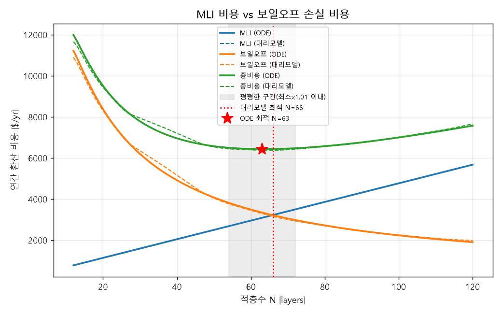
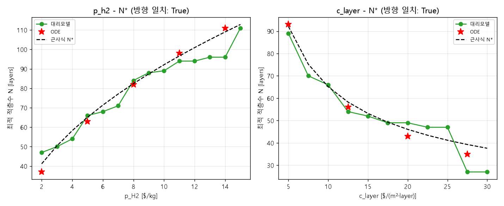
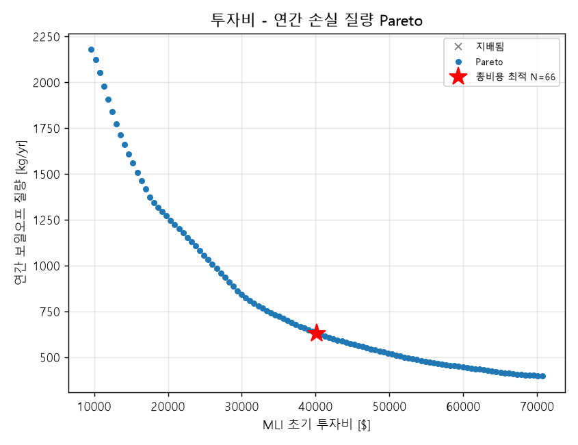

# 비용 최적화 보고서: opt_mlp_lhs_n500_seed42_seed0_tuned

| 항목 | 값 |
|---|---|
| 대리모델 최적 N | 66 |
| ODE 최적 N | 63 |
| 근사식 N* | 65.1 |
| 총비용 [$/yr] (ODE, 추천 N=64) | 6,429 |
| 연간 손실 질량 [kg/yr] (ODE, 추천 N) | 659.7 |

- 대리모델: `mlp_lhs_n500_seed42_seed0_tuned`. 보고 값은 ODE 재검증 값이다(헌법 I).
- 평평한 구간(총비용 <= 최소x1.01): (54, 72)
- 대리모델 최적 N의 ODE 총비용 상대오차: 0.0636%, N 차이(대리모델-ODE): 3
- 재검증 후보 N: [66, 67, 65, 64, 62], 후보 ODE 총비용 [$/yr]: [6433.3, 6437.0, 6430.7, 6429.3, 6430.4]
- 대리모델 최적화 시간: 1.7 ms

## 조건

- 설계 입력(N은 설계변수라 무시): {'N': 40, 'Nbar': 20, 'eps': 0.03, 'G_sup': 0.001, 'Pv0': 0.001, 'G_out': 1e-08, 'S': 0.001, 'R': 1.5, 'LD': 1.0, 'fill': 0.9}
- 경제 변수: c_layer=10.0 [$/(m²·layer)], c_fixed=50.0 [$/m²], p_H2=5.0 [$/kg], 수명=20.0 [yr], 할인율=0.05 [-] (CRF=0.08024)
- N 범위: (10, 120)

## 경고

- DEPLETED_EXCLUDED: 365일 잔량비 < 0.03인 N 2개를 후보에서 제외

## 출처

- 물리 모델 버전: 0.1.0, 소스 해시(sha256): 30fca2abec3acb66f9bee066a31574f411e3ed4595d0a1f40a6bd7cc4367bbdb
- 대리모델: `models\mlp_lhs_n500_seed42_seed0_tuned` (이름 mlp_lhs_n500_seed42_seed0_tuned), 학습 데이터셋 물리 지문: {'version': '0.1.0', 'sha256': '30fca2abec3acb66f9bee066a31574f411e3ed4595d0a1f40a6bd7cc4367bbdb'}
- physics_matches: True

## 그림

- p_h2: 대리모델 N 방향 일치 True, 근사식과 같은 방향 True
- c_layer: 대리모델 N 방향 일치 True, 근사식과 같은 방향 True

